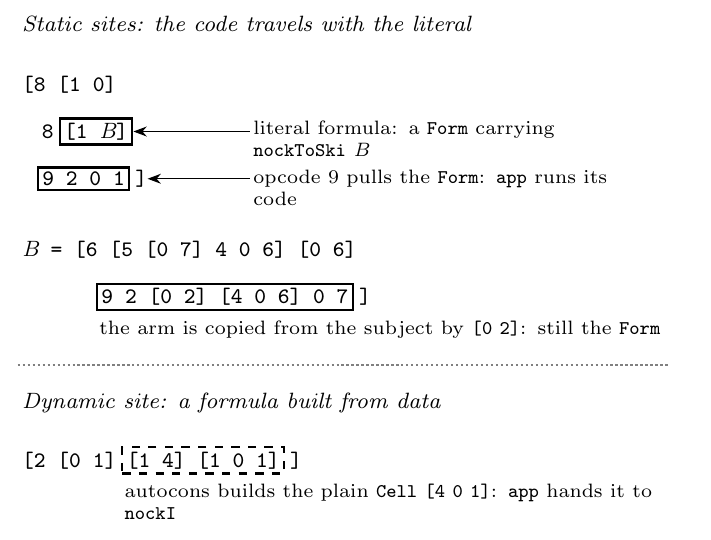

# nockmark

Annotated code fragments for LaTeX, drawn with TikZ: lines of code with solid
or dashed boxes around spans, notes in a right-hand column with arrows, notes
set under a box, headings and dotted dividers. Made for Nock, which has no
layout of its own, but any monospaced code works. pdfLaTeX, XeLaTeX and
LuaLaTeX.



```latex
\usepackage{nockmark}
...
\begin{nockmark}
  \nkheading{Static sites}
  \nkline{\nk{[8 [1 0]}}
  \nkline[1]{\nk{8 }\nkstatic{s1}{[1 \nkmeta{B}]}}
  \nknote{s1}{literal formula: a \texttt{Form} carrying its code}
  \nkrule
  \nkheading{Dynamic site}
  \nkline{\nk{[2 [0 1] }\nkdynamic{d1}{[1 4] [1 0 1]}\nk{]}}
  \nknotebelow{d1}{autocons builds a plain cell}
\end{nockmark}
```

Extracted from Figure 1 of *Nock in SKI* (Davis 2027). The manual is
`doc/nockmark.tex`.

## Use

Copy or symlink `tex/nockmark.sty` next to your document, or install it into
your TeX tree with `l3build install`.
